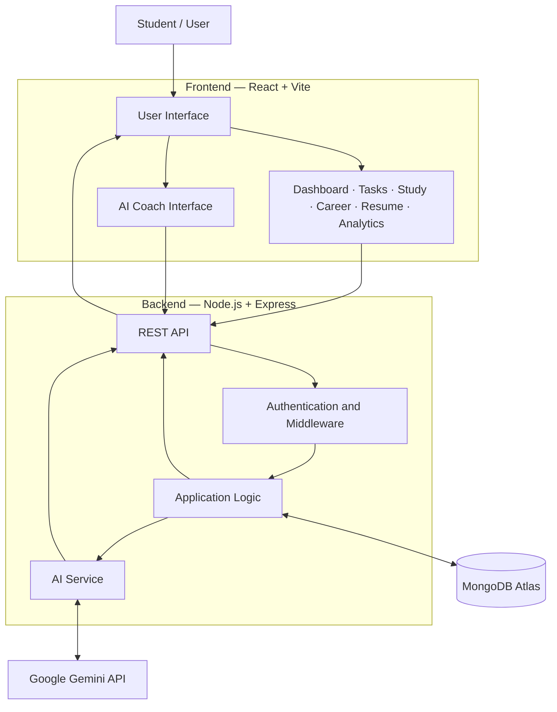

<div align="center">

# NEXORA

### AI-Powered Student Productivity & Career Intelligence Platform

**Plan smarter. Learn consistently. Build your future.**

NEXORA brings academic planning, study tracking, career preparation, project management, and AI-powered learning support together in one platform.

[Features](#-features) · [Architecture](#-system-architecture) · [Tech Stack](#-technology-stack) · [Getting Started](#-getting-started) · [Roadmap](#-future-roadmap)

</div>

---

## 📌 Overview

Students often manage their academic responsibilities, personal goals, projects, and career preparation across multiple disconnected tools.

**NEXORA** is designed to bring these activities into one organized workspace.

It helps students manage tasks, record study activity, monitor progress, explore career-related skills, build resumes, and use AI-powered tools for learning and preparation.

NEXORA is developed as a full-stack web application with a React frontend, Node.js and Express backend, MongoDB database, and Google Gemini API integration.

## 🎯 Problem Statement

Students face challenges such as:

- Keeping track of multiple academic tasks and deadlines.
- Maintaining consistent study habits.
- Understanding their learning and productivity progress.
- Organizing projects and career preparation.
- Finding accessible learning support when they need it.

NEXORA aims to address these challenges by providing a centralized platform for student productivity and career development.

## ✨ Features

### 📊 Student Dashboard
A centralized view of student activities and progress, helping users understand their current workload and stay organized.

### ✅ Task Management
Create, organize, prioritize, and manage tasks while keeping track of important deadlines.

### 📚 Study Tracker
Record study activity and review learning progress to encourage consistent study habits.

### 🧭 Career Intelligence
Explore career-related information, skills, and learning roadmaps to support career preparation.

### 💻 Projects Portfolio
Organize and showcase projects as part of a student's technical learning journey.

### 📄 Resume Builder
Create and manage resumes with tools designed to support professional and career preparation.

### 📈 Analytics
Visualize productivity and learning progress through charts and analytics.

### 🤖 AI Coach
Interact with an AI-powered assistant for explanations, learning support, and guidance.

### 🎓 AI Socratic Viva
Practice answering questions and strengthen understanding through interactive learning.

### 🧠 Memory & Privacy
Manage AI-related memory and privacy settings.

### 🔐 Authentication
User authentication and protected application functionality using JWT-based authentication.

---

## 🖥️ Screenshots

Screenshots help visitors understand the project before they explore the code.

_Add your actual screenshots to `docs/screenshots/` and update the paths below._

| Dashboard | Task Management |
|---|---|
|  |  |

| AI Coach | Analytics |
|---|---|
|  |  |

---

## 🏗️ System Architecture

NEXORA follows a **client–server architecture**. The frontend communicates with the backend through APIs. The backend handles application logic, database operations, authentication, and AI service integration.



### Architecture Overview

| Layer | Responsibility |
|---|---|
| Frontend | Displays the interface and handles user interactions |
| Backend | Processes requests and runs application logic |
| Authentication | Supports protected functionality using JWT |
| Database | Stores application data using MongoDB |
| AI Integration | Connects AI features to Google Gemini through an API |

The backend acts as the controlled connection between the frontend, database, and external AI services.

---

## 🛠️ Technology Stack

| Category | Technology |
|---|---|
| Frontend | React, Vite |
| Styling | Tailwind CSS |
| Backend | Node.js, Express.js |
| Database | MongoDB Atlas |
| ODM | Mongoose |
| Authentication | JSON Web Tokens (JWT) |
| AI Integration | Google Gemini API |
| Data Visualization | Recharts |
| Icons | Lucide |
| Version Control | Git, GitHub |
| Deployment | Render |

---

## 🔄 How NEXORA Works

A typical application workflow follows these steps:

1. The student interacts with the React frontend.
2. The frontend sends a request to the Express backend.
3. The backend validates and processes the request.
4. The backend interacts with MongoDB when data needs to be stored or retrieved.
5. For AI-powered functionality, the backend communicates with the Gemini API.
6. The backend returns the result to the frontend.
7. The frontend displays the updated information to the student.

This separation helps keep the user interface, application logic, data storage, and AI integration organized.

---

## 🚀 Getting Started

Follow these instructions to run NEXORA locally.

### Prerequisites

Make sure you have the following installed:

- [Node.js](https://nodejs.org/)
- npm
- [Git](https://git-scm.com/)
- A MongoDB database
- A Gemini API key for AI features

### 1. Clone the repository

```bash
git clone https://github.com/CodeX-Anurag/NEXORA-.git
cd NEXORA-
```

### 2. Install backend dependencies

```bash
cd backend
npm install
```

### 3. Configure backend environment variables

Create a `.env` file inside the `backend` directory.

Add the environment variables required by your backend configuration.

Example:

```env
PORT=5000
MONGODB_URI=your_mongodb_connection_string
JWT_SECRET=your_jwt_secret
GEMINI_API_KEY=your_gemini_api_key
```

> **Important:** These are example variable names. Check the backend source code and use the exact names expected by your application. Never commit real credentials or API keys.

### 4. Start the backend

Use the appropriate start script defined in `backend/package.json`.

For example:

```bash
npm start
```

### 5. Install frontend dependencies

Open a new terminal from the project root:

```bash
cd frontend
npm install
```

### 6. Configure the frontend API URL

Configure the frontend to communicate with your local backend.

For example:

```env
VITE_API_URL=http://localhost:5000
```

Check the frontend configuration to confirm the correct environment variable name and expected API URL format.

### 7. Start the frontend

```bash
npm run dev
```

Open the local URL printed by Vite in your terminal.

---

## 🔐 Environment Variables & Security

NEXORA uses environment variables for application configuration and sensitive credentials.

Depending on the backend configuration, these may include:

- MongoDB connection string
- JWT secret
- Gemini API key
- Backend port
- Frontend API base URL

Security recommendations:

- Keep `.env` files out of version control.
- Never expose private API keys in frontend code.
- Use strong secrets for authentication.
- Restrict database access to trusted sources.
- Avoid logging passwords, tokens, or database credentials.
- Use separate configuration values for local development and production.

---

## 🧪 Testing

NEXORA includes tests for selected application features.

To run tests, use the scripts defined in the relevant `package.json` files.

For example:

```bash
npm test
```

The exact command may differ between the frontend and backend. Check the available scripts before running it.

---

## 🧠 AI Integration

NEXORA integrates Google Gemini through an API for AI-powered functionality.

The backend communicates with the AI provider and returns generated responses to the frontend. This allows the application to use AI capabilities without hosting or training a large language model directly.

The AI integration is intended to support learning and productivity—not to replace independent learning or guarantee academic or career outcomes.

---

## 🔮 Future Roadmap

NEXORA is an evolving project. Potential future improvements include:

- AI provider fallback and improved quota handling.
- Retrieval-Augmented Generation (RAG) for student notes and documents.
- Personalized AI study-plan generation.
- AI-generated quizzes and revision material.
- Improved study analytics and progress insights.
- More robust monitoring and deployment reliability.
- Additional career preparation and interview practice tools.

---

## 👨‍💻 Author

**Anurag Soni**  
B.Tech — Computer Science & Engineering

GitHub: [@CodeX-Anurag](https://github.com/CodeX-Anurag)

---

## 🙌 Acknowledgements

NEXORA was developed as a student software project and learning experience.

The development process involved implementation, testing, debugging, refinement, and the use of AI-assisted development tools.

The project will continue to evolve as new ideas, technologies, and improvements are explored.

---

## 📄 License

A license has not been specified in this README.

If you intend to allow others to use, modify, or distribute the project, consider adding an appropriate open-source license. Without a license, others should not assume they have permission to reuse or redistribute the code.

---

<div align="center">

**NEXORA — Your journey from student productivity to career readiness.**

</div>
