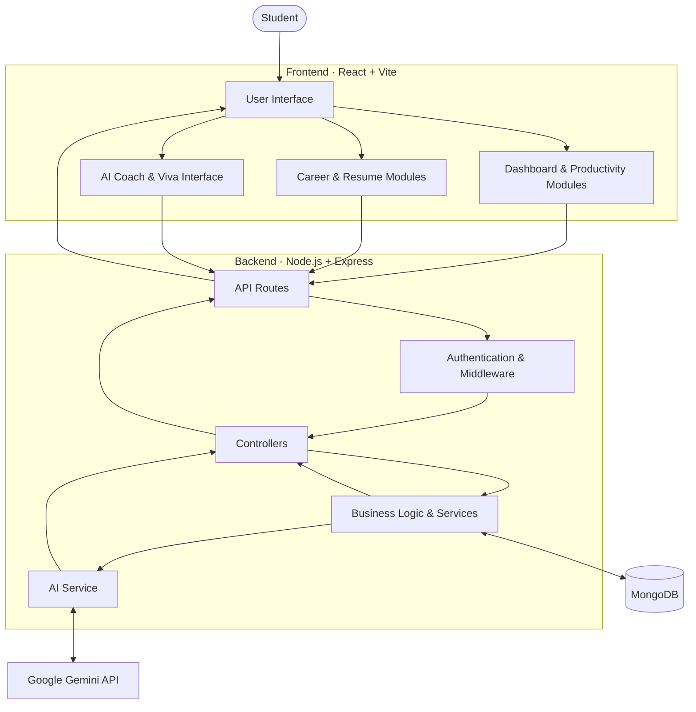
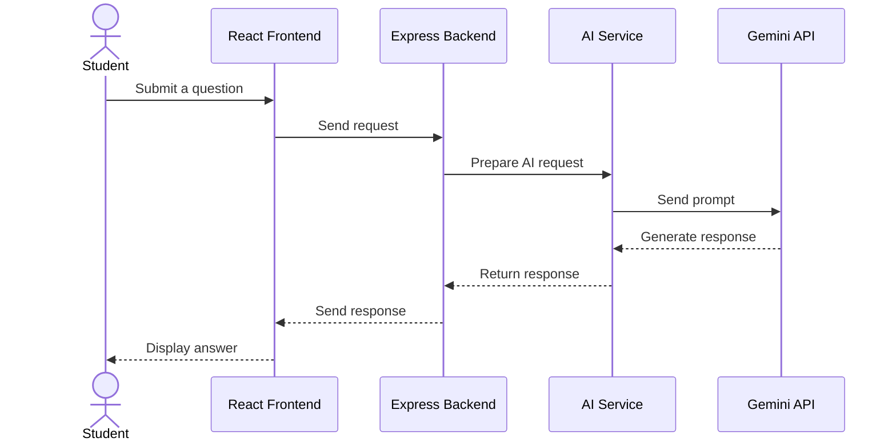

<div align="center">

# NEXORA

### AI-Powered Student Productivity & Career Intelligence Platform

**Plan smarter. Learn consistently. Build your future.**

A unified workspace for students to organize their academic life, track learning progress, prepare for careers, and access AI-powered learning support.

[Explore Features](#-features) · [Architecture](#-system-architecture) · [Installation](#-getting-started) · [Roadmap](#-future-roadmap)

</div>

---

## 🌟 About NEXORA

Student life involves more than attending classes. Students need to manage assignments, build consistent study habits, work on projects, develop technical skills, and prepare for future careers.

These responsibilities are often scattered across different tools.

**NEXORA brings these activities into one platform.**

It combines student productivity tools with career-oriented features and AI-assisted learning, helping students organize their work and understand their progress.

> NEXORA is designed to support students—not replace their effort, judgment, or learning.

---

## 🎯 The Problem We’re Solving

Students commonly face challenges such as:

- Managing multiple tasks, deadlines, and academic responsibilities.
- Maintaining consistent study routines.
- Understanding their productivity and learning progress.
- Organizing projects and career preparation.
- Finding accessible support when they are learning difficult topics.

NEXORA addresses these challenges through a centralized student workspace.

## ✨ Features

<table>
<tr>
<td width="50%">

### 📊 Student Dashboard
A central overview of student activities and progress.

</td>
<td width="50%">

### ✅ Task Management
Organize tasks, priorities, and deadlines in one place.

</td>
</tr>
<tr>
<td>

### 📚 Study Tracker
Record study activity and review learning progress.

</td>
<td>

### 🧭 Career Intelligence
Explore career-related skills and learning roadmaps.

</td>
</tr>
<tr>
<td>

### 💻 Projects Portfolio
Organize and showcase projects from your technical journey.

</td>
<td>

### 📄 Resume Builder
Create and manage resumes for career preparation.

</td>
</tr>
<tr>
<td>

### 📈 Analytics
Visualize productivity and learning progress.

</td>
<td>

### 🤖 AI Coach
Get AI-assisted explanations and learning support.

</td>
</tr>
<tr>
<td>

### 🎓 AI Socratic Viva
Practice answering questions and strengthen understanding.

</td>
<td>

### 🧠 Memory & Privacy
Manage AI-related memory and privacy settings.

</td>
</tr>
</table>

---

## 🖥️ Project Preview

Add screenshots of your actual application to make the repository more engaging.

Suggested structure:

```text
docs/
└── screenshots/
    ├── dashboard.png
    ├── tasks.png
    ├── study-tracker.png
    ├── career.png
    ├── resume-builder.png
    └── ai-coach.png
```

Then embed them in this section:

| Dashboard | Task Management |
|---|---|
|  |  |

| Study Tracker | AI Coach |
|---|---|
|  |  |

*Replace the example paths with your real screenshot files. Remove any screenshot row you have not added yet.*

---

## 🏗️ System Architecture

NEXORA uses a **client–server architecture**. The frontend handles the user interface, while the backend processes requests, applies application logic, communicates with the database, and connects to AI services.



### Architecture Components

| Component | Role |
|---|---|
| React frontend | Renders the application interface and manages user interactions |
| Express API | Receives and routes client requests |
| Middleware | Supports request processing and authentication |
| Controllers and services | Implement application behavior and business logic |
| MongoDB | Stores application data |
| Gemini API | Provides AI-generated responses for supported features |

---

## 🔄 How an AI Request Works

The AI Coach uses the backend as an intermediary between the frontend and the AI provider.



This design keeps the AI integration on the backend instead of exposing the provider’s secret API key in the browser.

---

## 🛠️ Technology Stack

| Category | Technologies |
|---|---|
| Frontend | React, Vite |
| Styling | Tailwind CSS |
| Backend | Node.js, Express.js |
| Database | MongoDB |
| ODM | Mongoose |
| Authentication | JSON Web Tokens (JWT) |
| AI Integration | Google Gemini API |
| Data Visualization | Recharts |
| Icons | Lucide |
| Version Control | Git, GitHub |
| Deployment Platform | Render |

---

## 🚀 Getting Started

Follow these steps to run NEXORA locally.

### Prerequisites

Install the following:

- [Node.js](https://nodejs.org/)
- npm
- [Git](https://git-scm.com/)
- A MongoDB database
- A Gemini API key for AI-powered features

### 1. Clone the repository

```bash
git clone https://github.com/CodeX-Anurag/NEXORA-.git
cd NEXORA-
```

### 2. Install backend dependencies

```bash
cd backend
npm install
```

### 3. Configure backend environment variables

Create a `.env` file inside the `backend` directory.

Example configuration:

```env
PORT=5000
MONGODB_URI=your_mongodb_connection_string
JWT_SECRET=your_jwt_secret
GEMINI_API_KEY=your_gemini_api_key
```

**Important:** These are example names. Confirm the exact environment variable names in your backend code before using them. Never commit real credentials.

### 4. Start the backend

Run the start command defined in `backend/package.json`.

For example:

```bash
npm start
```

### 5. Install frontend dependencies

Open another terminal from the project root:

```bash
cd frontend
npm install
```

### 6. Configure the frontend API URL

Set the backend URL using the environment variable expected by the frontend.

Example:

```env
VITE_API_URL=http://localhost:5000
```

Confirm the actual variable name and URL format in your frontend configuration.

### 7. Start the frontend

```bash
npm run dev
```

Open the local URL printed by Vite.

---

## 🔐 Security

NEXORA uses environment variables to configure sensitive credentials and application settings.

Recommended practices:

- Keep `.env` files out of Git.
- Never expose private API keys in frontend code.
- Use a strong JWT secret.
- Restrict database access to trusted sources.
- Avoid logging passwords, tokens, or database credentials.
- Use separate configuration for local development and production.

---

## 🧪 Testing

NEXORA contains tests for selected application features.

Check the scripts in the backend and frontend `package.json` files to find the supported test commands.

For example:

```bash
npm test
```

Use the command supported by the relevant package.

---

## 🧠 AI Integration

NEXORA integrates Google Gemini through an API for supported AI-powered features.

The backend sends requests to the AI provider and returns generated responses to the frontend. This allows NEXORA to use a hosted language model without training or hosting a large model itself.

AI features are intended to assist with learning and productivity. They do not guarantee academic results, interview success, or job placement.

---

## 🔮 Future Roadmap

NEXORA is an evolving project. Potential future improvements include:

- AI provider fallback and better API quota handling.
- Retrieval-Augmented Generation (RAG) for personal study documents.
- Personalized study-plan generation.
- AI-generated quizzes and revision material.
- More detailed study and productivity analytics.
- Improved error handling, monitoring, and deployment reliability.
- Expanded career preparation and interview practice tools.

---

## 👨‍💻 Author

**Anurag Soni**  
B.Tech · Computer Science & Engineering

GitHub: [@CodeX-Anurag](https://github.com/CodeX-Anurag)

---

## 🙌 Acknowledgements

NEXORA was developed as a student software project and learning experience.

The development process included implementation, testing, debugging, refinement, and the use of AI-assisted development tools.

The project will continue to evolve through future improvements and new ideas.

---

## 📄 License

No license has been specified yet.

If you intend to allow others to use, modify, or distribute this project, consider adding an appropriate open-source license. Without a license, visitors should not assume they have permission to reuse or redistribute the code.

---

<div align="center">

### NEXORA

**Your journey from student productivity to career readiness.**

</div>
