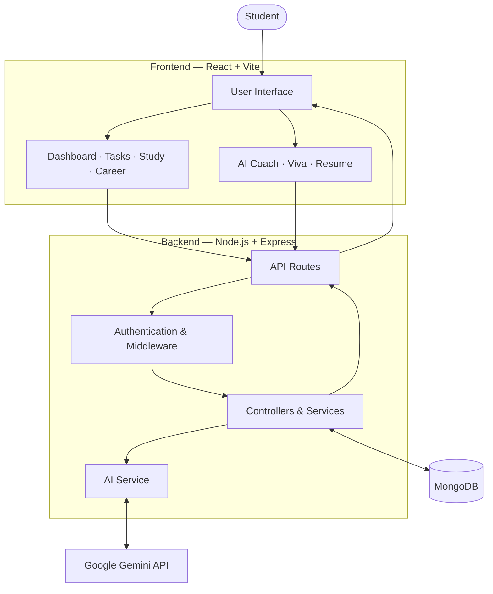
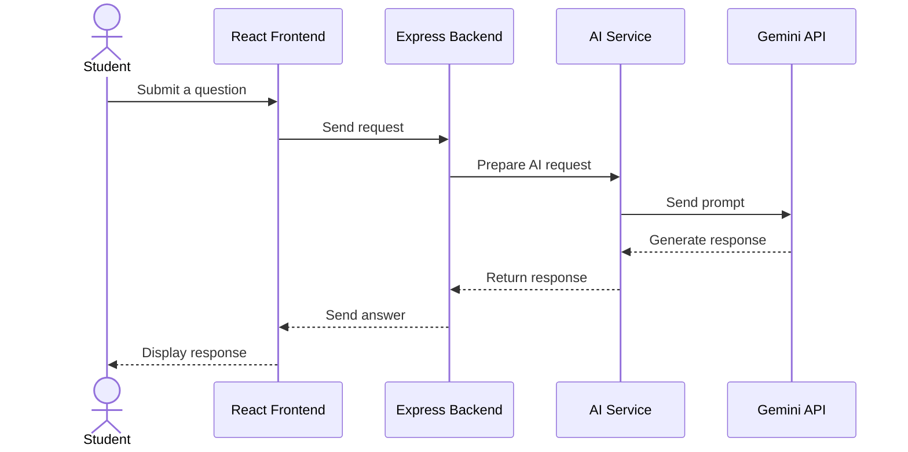

<div align="center">

# NEXORA

### AI-Powered Student Productivity & Career Intelligence Platform

**Plan smarter. Learn consistently. Build your future.**

A unified workspace for students to organize academic responsibilities, track learning progress, prepare for careers, and access AI-powered learning support.

</div>

---

## 🌟 About NEXORA

Student life involves more than attending classes. Students manage assignments, study schedules, projects, technical skills, and career preparation—often across multiple disconnected tools.

**NEXORA brings these activities into one platform.**

It combines student productivity tools, career-oriented features, and AI-assisted learning to help students organize their work and understand their progress.

## 🎯 Problem Statement

Students often face challenges such as:

- Managing multiple academic tasks and deadlines.
- Maintaining consistent study routines.
- Understanding their learning and productivity progress.
- Organizing projects and career preparation.
- Finding support when learning difficult topics.

NEXORA aims to address these challenges through a centralized student workspace.

---

## ✨ Features

| Feature | Description |
|---|---|
| 📊 Student Dashboard | Overview of student activities and progress |
| ✅ Task Management | Organize tasks, priorities, and deadlines |
| 📚 Study Tracker | Record study activity and review progress |
| 🧭 Career Intelligence | Explore career-related skills and learning roadmaps |
| 💻 Projects Portfolio | Organize and showcase technical projects |
| 📄 Resume Builder | Create and manage resumes |
| 📈 Analytics | Visualize productivity and learning progress |
| 🤖 AI Coach | AI-assisted explanations and learning support |
| 🎓 AI Socratic Viva | Practice answering questions interactively |
| 🧠 Memory & Privacy | Manage AI-related memory and privacy settings |

---

## 🏗️ System Architecture

NEXORA follows a **client–server architecture**. The frontend handles the user interface, while the backend processes requests, manages application logic, communicates with the database, and connects to AI services.



### Architecture Components

- **Frontend:** Renders the application interface and handles user interactions.
- **Backend:** Receives requests and processes application logic.
- **Authentication:** Supports protected functionality using JWT.
- **Database:** Stores application data using MongoDB.
- **AI Integration:** Connects supported AI features to Google Gemini.

---

## 🔄 AI Request Flow

The AI Coach communicates with the AI provider through the backend. This keeps the provider’s secret API key out of the browser.



---

## 🛠️ Technology Stack

| Category | Technology |
|---|---|
| Frontend | React, Vite |
| Styling | Tailwind CSS |
| Backend | Node.js, Express.js |
| Database | MongoDB |
| ODM | Mongoose |
| Authentication | JSON Web Tokens (JWT) |
| AI Integration | Google Gemini API |
| Data Visualization | Recharts |
| Icons | Lucide |
| Version Control | Git, GitHub |
| Deployment Platform | Render |

---

## 🚀 Getting Started

Follow these instructions to run NEXORA locally.

### Prerequisites

- [Node.js](https://nodejs.org/)
- npm
- [Git](https://git-scm.com/)
- MongoDB database
- Gemini API key for AI-powered features

### 1. Clone the repository

```bash
git clone https://github.com/CodeX-Anurag/NEXORA-.git
cd NEXORA-
```

### 2. Install backend dependencies

```bash
cd backend
npm install
```

### 3. Configure backend environment variables

Create a `.env` file inside the `backend` directory.

Example:

```env
PORT=5000
MONGODB_URI=your_mongodb_connection_string
JWT_SECRET=your_jwt_secret
GEMINI_API_KEY=your_gemini_api_key
```

> These are example variable names. Confirm the exact names in your backend code before using them. Never commit real credentials or API keys.

### 4. Start the backend

Run the start command defined in `backend/package.json`.

For example:

```bash
npm start
```

### 5. Install frontend dependencies

Open another terminal from the project root:

```bash
cd frontend
npm install
```

### 6. Configure the frontend API URL

Set the backend URL using the environment variable expected by the frontend.

Example:

```env
VITE_API_URL=http://localhost:5000
```

Confirm the exact variable name and URL format in your frontend configuration.

### 7. Start the frontend

```bash
npm run dev
```

Open the local URL printed by Vite.

---

## 🔐 Security

- Keep `.env` files out of version control.
- Never expose private API keys in frontend code.
- Use a strong JWT secret.
- Restrict database access to trusted sources.
- Avoid logging passwords, tokens, or database credentials.
- Use separate configuration for local development and production.

---

## 🧪 Testing

NEXORA includes tests for selected application features.

Check the scripts in the backend and frontend `package.json` files to find the supported test commands.

For example:

```bash
npm test
```

The exact command may differ between packages.

---

## 🧠 AI Integration

NEXORA integrates Google Gemini through an API for supported AI-powered features.

The backend sends requests to the AI provider and returns generated responses to the frontend. This allows the application to use a hosted language model without training or hosting a large model itself.

AI features are intended to assist with learning and productivity. They do not guarantee academic results, interview success, or job placement.

---

## 🔮 Future Roadmap

Potential future improvements include:

- AI provider fallback and improved API quota handling.
- Retrieval-Augmented Generation (RAG) for personal study documents.
- Personalized study-plan generation.
- AI-generated quizzes and revision material.
- More detailed study and productivity analytics.
- Improved error handling, monitoring, and deployment reliability.
- Expanded career preparation and interview practice tools.

---

## 👨‍💻 Author

**Anurag Soni**  
B.Tech · Computer Science & Engineering

GitHub: [@CodeX-Anurag](https://github.com/CodeX-Anurag)

---

## 🙌 Acknowledgements

NEXORA was developed as a student software project and learning experience.

The development process included implementation, testing, debugging, refinement, and the use of AI-assisted development tools.

The project will continue to evolve through future improvements and new ideas.

---

## 📄 License

No license has been specified yet.

If you intend to allow others to use, modify, or distribute this project, consider adding an appropriate open-source license. Without a license, visitors should not assume they have permission to reuse or redistribute the code.

---

<div align="center">

**NEXORA — Your journey from student productivity to career readiness.**

</div>
