<div align="center">

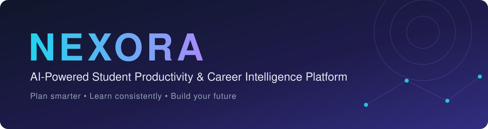

<br/>


**[Features](#-features) · [Architecture](#-system-architecture) · [Tech Stack](#-technology-stack) · [Getting Started](#-getting-started) · [Roadmap](#-roadmap)**

</div>

---

## 📌 Overview

Students often manage coursework, personal goals, projects, and career preparation across several disconnected tools.

**NEXORA** brings these into a single workspace. It helps students plan tasks, log study sessions, track progress, explore career skills, build resumes, and learn with AI-powered support.

It is a full-stack web application built with **React**, **Node.js + Express**, **MongoDB**, and the **Google Gemini API**.

## 🎯 Problem & Solution

| Challenge students face | How NEXORA helps |
|---|---|
| Juggling many tasks and deadlines | Prioritized task management and a unified dashboard |
| Inconsistent study habits | Study tracker with progress review |
| No clear view of progress | Analytics with charts |
| Scattered projects and career prep | Projects portfolio, career intelligence, resume builder |
| Limited access to learning support | AI Coach and AI Socratic Viva |

## ✨ Features

<div align="center">
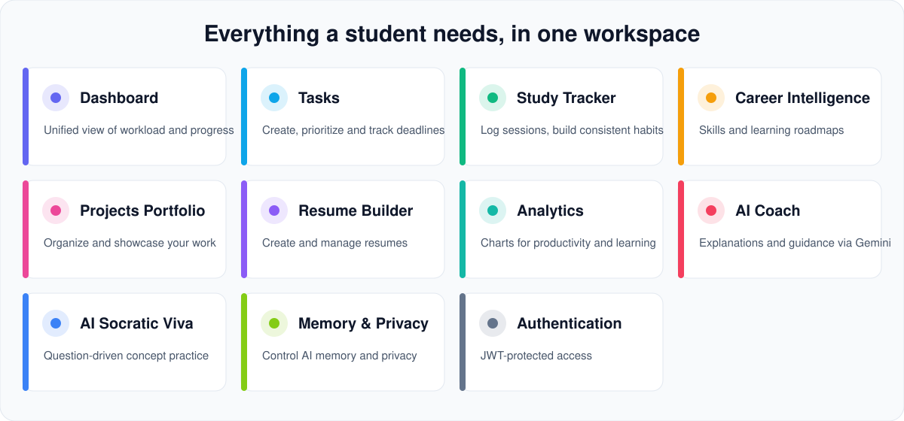
</div>

<br/>

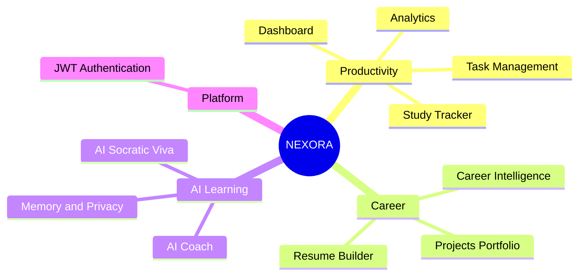

| Module | Description |
|---|---|
| 📊 **Dashboard** | Central view of activities, workload, and progress |
| ✅ **Task Management** | Create, organize, and prioritize tasks with deadlines |
| 📚 **Study Tracker** | Record study activity and review learning progress |
| 🧭 **Career Intelligence** | Explore career information, skills, and learning roadmaps |
| 💻 **Projects Portfolio** | Organize and showcase technical projects |
| 📄 **Resume Builder** | Create and manage resumes |
| 📈 **Analytics** | Charts for productivity and learning trends |
| 🤖 **AI Coach** | AI assistant for explanations, learning support, and guidance |
| 🎓 **AI Socratic Viva** | Interactive question-driven practice to deepen understanding |
| 🧠 **Memory & Privacy** | Manage AI memory and privacy settings |
| 🔐 **Authentication** | JWT-based protected access |

## 🖥️ Screenshots

<table>
  <tr>
    <td align="center" width="50%"><b>Dashboard</b><br/>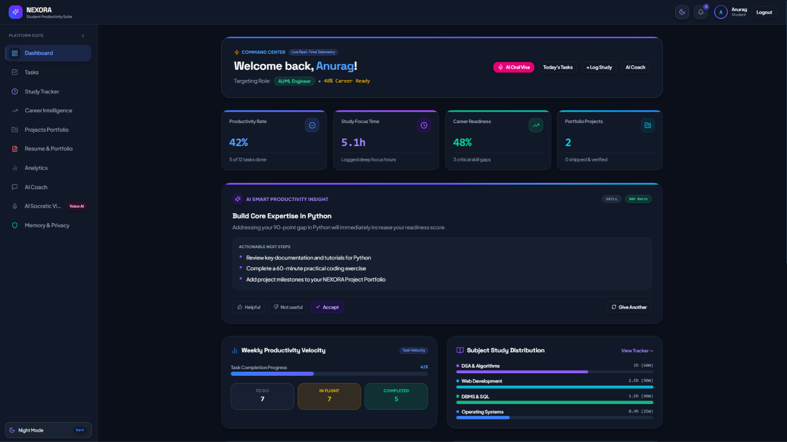</td>
    <td align="center" width="50%"><b>Task Management</b><br/>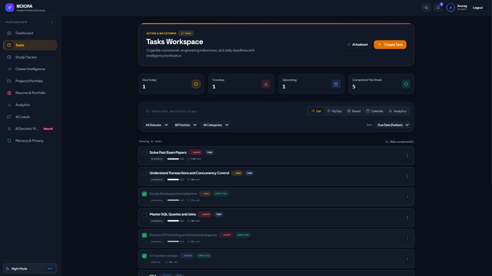</td>
  </tr>
  <tr>
    <td align="center"><b>Analytics</b><br/>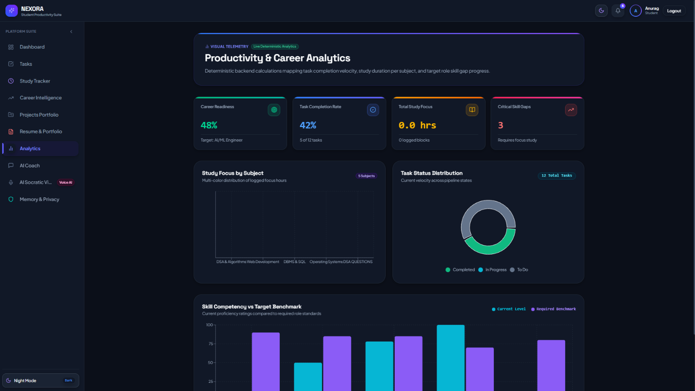</td>
    <td align="center"><b>Career Intelligence</b><br/></td>
  </tr>
  <tr>
    <td align="center"><b>Resume Builder</b><br/></td>
    <td align="center"><b>AI Coach</b><br/></td>
  </tr>
  <tr>
    <td align="center"><b>AI Socratic Viva</b><br/></td>
    <td></td>
  </tr>
</table>

## 🏗️ System Architecture

NEXORA follows a **client–server architecture**. The React frontend talks to the Express backend over a REST API; the backend handles authentication, business logic, database access, and AI integration.

<div align="center">
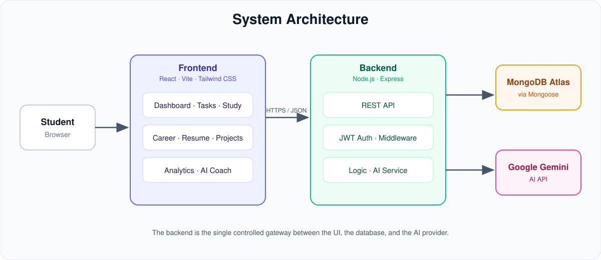
</div>

<br/>

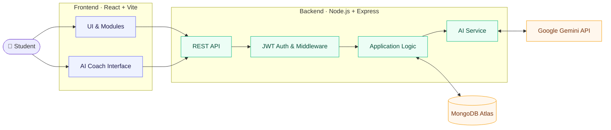

| Layer | Responsibility |
|---|---|
| **Frontend** | Renders the interface and handles user interaction |
| **Backend** | Validates requests and runs application logic |
| **Authentication** | Protects routes using JWT |
| **Database** | Persists application data in MongoDB |
| **AI Integration** | Connects AI features to Google Gemini via API |

## 🔄 How NEXORA Works

### Standard request flow

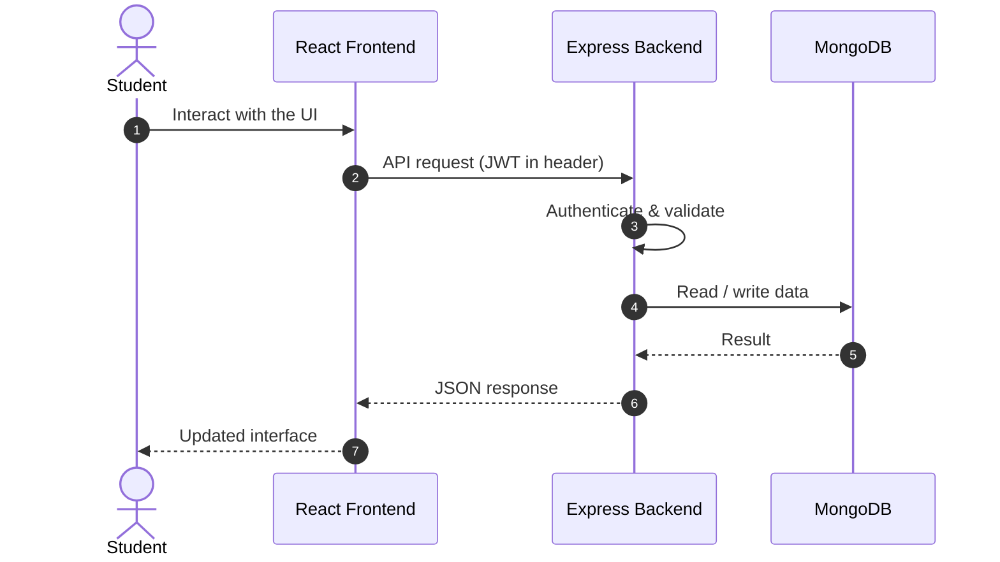

### AI-powered request flow

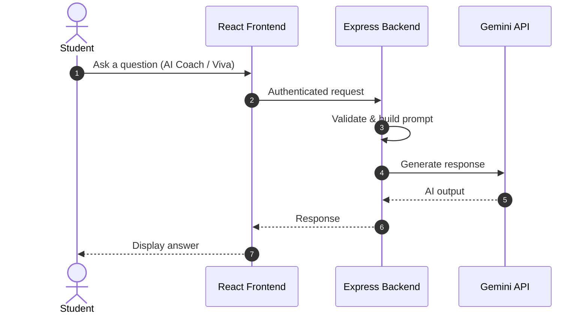

> The Gemini API key lives only on the backend and is never exposed to the browser.

## 🛠️ Technology Stack

| Category | Technology |
|---|---|
| Frontend | React, Vite |
| Styling | Tailwind CSS |
| Backend | Node.js, Express.js |
| Database | MongoDB Atlas, Mongoose |
| Authentication | JSON Web Tokens (JWT) |
| AI Integration | Google Gemini API |
| Visualization | Recharts |
| Icons | Lucide |
| Tooling | Git, GitHub |
| Deployment | Render |

## 🚀 Getting Started

### Prerequisites

- [Node.js](https://nodejs.org/) and npm
- [Git](https://git-scm.com/)
- A MongoDB database (e.g. [MongoDB Atlas](https://www.mongodb.com/atlas))
- A [Gemini API key](https://aistudio.google.com/app/apikey)

### 1. Clone the repository

```bash
git clone https://github.com/CodeX-Anurag/NEXORA-.git
cd NEXORA-
```

### 2. Set up the backend

```bash
cd backend
npm install
```

Create `backend/.env`:

```env
PORT=5000
MONGODB_URI=your_mongodb_connection_string
JWT_SECRET=your_jwt_secret
GEMINI_API_KEY=your_gemini_api_key
```

Start the server:

```bash
npm start
```

### 3. Set up the frontend

In a new terminal:

```bash
cd frontend
npm install
```

Create `frontend/.env`:

```env
VITE_API_URL=http://localhost:5000
```

Start the dev server:

```bash
npm run dev
```

Open the local URL printed by Vite (typically `http://localhost:5173`).

### Environment variables

| Variable | Location | Purpose |
|---|---|---|
| `PORT` | backend | Server port |
| `MONGODB_URI` | backend | MongoDB connection string |
| `JWT_SECRET` | backend | Secret used to sign JWTs |
| `GEMINI_API_KEY` | backend | Google Gemini API key |
| `VITE_API_URL` | frontend | Base URL of the backend API |

## 🔐 Security

- Keep `.env` files out of version control.
- Never expose private API keys in frontend code.
- Use long, random values for `JWT_SECRET`.
- Restrict database network access to trusted sources.
- Avoid logging passwords, tokens, or credentials.
- Use separate configuration for development and production.

## 🧪 Testing

```bash
npm test
```

Run this from the `backend` or `frontend` directory, according to the scripts defined in each `package.json`.

## 🧠 AI Integration

NEXORA calls Google Gemini through its API, so no model is hosted or trained locally. The backend sends requests to the provider and returns responses to the frontend.

AI features are meant to **support** learning and productivity, not replace independent study or guarantee academic or career outcomes.

## 🔮 Roadmap

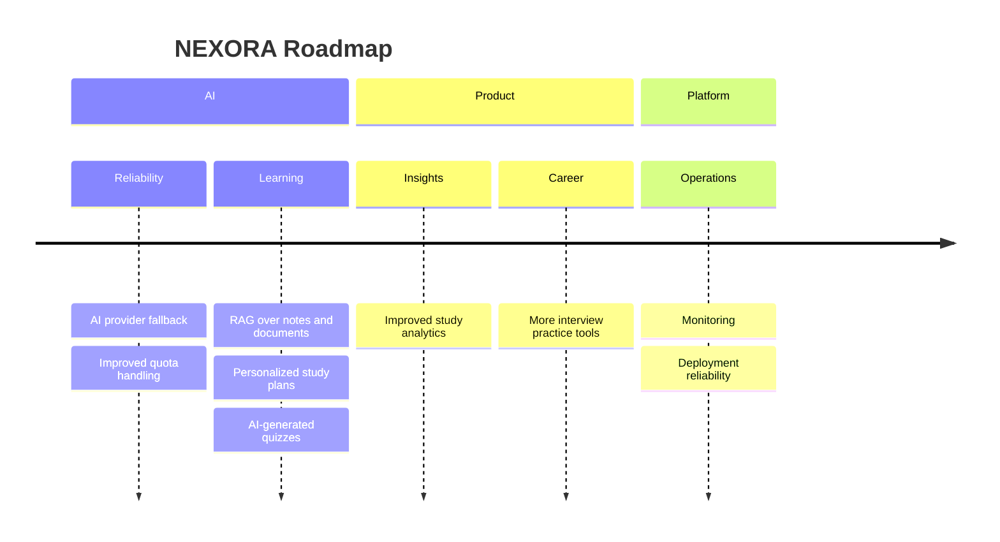

- [ ] AI provider fallback and improved quota handling
- [ ] Retrieval-Augmented Generation (RAG) for notes and documents
- [ ] Personalized AI study-plan generation
- [ ] AI-generated quizzes and revision material
- [ ] Improved study analytics and progress insights
- [ ] Stronger monitoring and deployment reliability
- [ ] Additional career preparation and interview practice tools

## 🤝 Contributing

Suggestions and improvements are welcome. Open an issue to discuss a change, or fork the repository and submit a pull request.

## 👨‍💻 Author

**Anurag Soni** — B.Tech, Computer Science & Engineering
GitHub: [@CodeX-Anurag](https://github.com/CodeX-Anurag)

## 🙏 Acknowledgements

NEXORA was built as a student software project and learning experience, with implementation, testing, debugging, and refinement supported by AI-assisted development tools.

## 📄 License

No license has been specified yet. Add a `LICENSE` file (for example, MIT) to let others use, modify, or distribute the project.

---

<div align="center">

**NEXORA — Your journey from student productivity to career readiness.**

</div>
